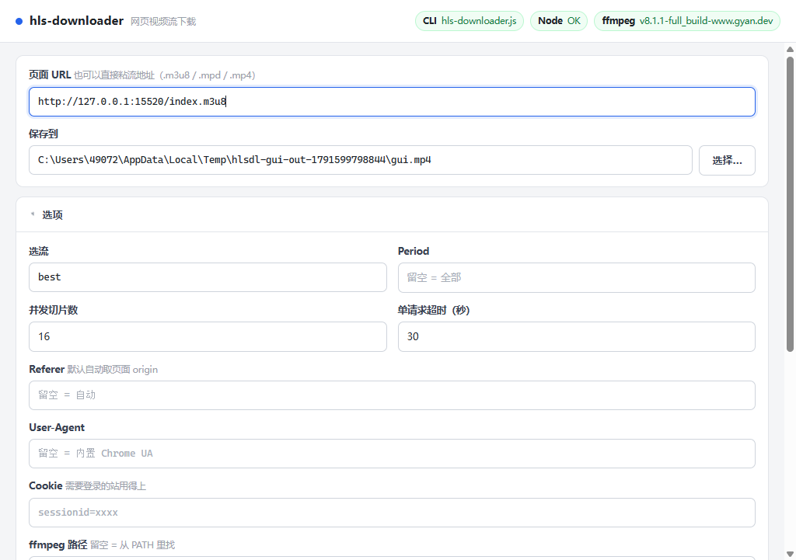
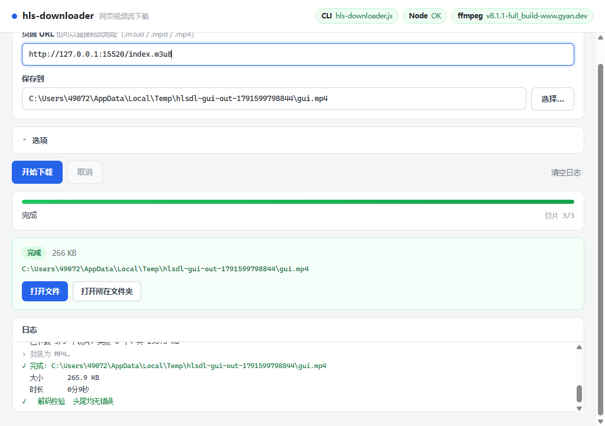

# hls-downloader GUI

`hls-downloader.js` 的图形界面（Electron 封装）。不想敲命令行时用这个。

**它不是另写一套下载逻辑**——界面只是个壳，真正的活儿全交给旁边那个已经过了 21 项自测的 CLI。
所以 CLI 里每一条被测试覆盖的代码路径，就是界面实际走的路径。

```
┌─────────────────────┐        spawn         ┌──────────────────────┐
│  Electron 界面      │  ──────────────────▶ │  hls-downloader.js   │
│  (renderer + 主进程) │                      │  （已验证的 CLI）     │
│                     │  ◀── stdout/stderr ─ │                      │
└─────────────────────┘   @@HLSDL@@ 进度事件  └──────────────────────┘
```

> **只是想双击运行、不想装 Node？** 直接看「[打包成 exe](#打包成-exe发给别人--拷-u-盘)」一节，
> 那里产出的单个 `.exe` 内置了 Node、CLI 和 ffmpeg，拷到任何 Windows 机器上双击就能用。

---

## 跑起来

```bash
cd gui
npm install          # 只装 electron 一个依赖
npm start
```

### `npm install` 卡在下载 electron 二进制？

Electron 的 npm 包在 `postinstall` 阶段从 GitHub Releases 拉一个 ~370MB 的二进制。
国内网络下这一步经常悄悄失败——`npm install` 报"added 13 packages"看着成功了，
但 `node_modules/electron/dist/` 是空的，启动时报 `Electron failed to install correctly`。

走 npmmirror 镜像：

```bash
# Windows (cmd)
set ELECTRON_MIRROR=https://npmmirror.com/mirrors/electron/
npm install

# Windows (PowerShell)
$env:ELECTRON_MIRROR="https://npmmirror.com/mirrors/electron/"; npm install

# macOS / Linux
ELECTRON_MIRROR=https://npmmirror.com/mirrors/electron/ npm install
```

要是已经装过了、只是二进制没下来，不用删 `node_modules` 重来，单独补一下：

```bash
# Windows
set ELECTRON_MIRROR=https://npmmirror.com/mirrors/electron/
node node_modules/electron/install.js
```

装完自检一下（能打印版本号就对了）：

```bash
node_modules/electron/dist/electron.exe --version    # Windows
node_modules/electron/dist/Electron.app/Contents/MacOS/Electron --version   # macOS
```

### 依赖

| 需要什么 | 说明 |
|---|---|
| **ffmpeg** | 开发模式（`npm start`）必须有。切片下载完要它封装成 MP4。装好并加进 PATH，或在界面「选项 → ffmpeg 路径」里指定。**打包版不需要**——ffmpeg 已经内置在 exe 里 |
| **Node.js** | **不需要单独装**。界面用 Electron 自带的 Node 跑 CLI（`process.execPath` + `ELECTRON_RUN_AS_NODE=1`） |
| **hls-downloader.js** | 必须在界面能找得到的地方，见下面「界面怎么找 CLI」 |

---

## 一个必须知道的坑：`ELECTRON_RUN_AS_NODE`

如果你从某些 IDE 内置终端、或装了 AI 工具链的 shell 里启动，环境里可能被设了
`ELECTRON_RUN_AS_NODE=1`。这个变量会让 `electron.exe` **退化成纯 Node.js**，
于是 `require('electron')` 只返回一个路径字符串，`ipcMain` 是 `undefined`，启动直接崩：

```
TypeError: Cannot read properties of undefined (reading 'handle')
    at Object.<anonymous> (.../main.js:83:1)
Node.js v24.x.x          ← 注意这行：它自报是 Node，不是 Electron
```

判断方法（报错头里出现 `Node.js vX` 而不是 Electron 版本，基本就是它）：

```bash
env | grep -i ELECTRON
# ELECTRON_RUN_AS_NODE=1     ← 中招了
```

**不用自己处理**——`launch.js` 已经在 spawn Electron 之前把这个变量删掉了，
`npm start` 走的就是它。只有你绕过 `npm start` 直接 `electron .` 时才会踩到。

> 顺带一提：`npm start` 之所以不是 `electron .`，就是为了让 `launch.js` 有机会清掉这个变量。
> 直接跑 `npx electron .` 在干净环境里没问题，在上述环境里就会崩。

---

## 界面怎么找 CLI

按顺序找，第一个存在的就用：

1. 环境变量 `HLSDL_CLI`（指向 `hls-downloader.js` 的完整路径）
2. `../hls-downloader.js` —— 技能目录的布局（`gui/` 和 CLI 平级）
3. `../hls-downloader/hls-downloader.js` —— 工作区的布局
4. `./hls-downloader.js`

都不在就用环境变量硬指：

```bash
set HLSDL_CLI=D:\some\path\hls-downloader.js
npm start
```

界面顶栏有三个状态标签（chip）——**CLI / Node / ffmpeg**，绿的才可用。
CLI 或 ffmpeg 标红时，日志区会直接告诉你缺什么。

---

## 用法

1. **页面 URL**：粘视频所在网页的地址。也可以直接粘流地址（`.m3u8` / `.mpd` / `.mp4` 等）——
   界面认出来是流地址后，会跳过浏览器嗅探直接下，同时仍从它的 origin 推导 `Referer`
   （少了这个头很多 CDN 直接 403）。
2. **保存到**：留空则按链接自动命名。点「选择…」可以挑文件路径。
3. **选项**（默认收起）：
   - **选流** `best` / `worst` / `1280x720` / 带宽数字
   - **Period**：DASH 多 Period 清单里只下某一段，留空 = 全部
   - **并发切片数**（默认 16）、**单请求超时**（默认 30 秒）
   - **Referer** / **User-Agent** / **Cookie**：需要登录或防盗链的站用得上
   - **ffmpeg 路径**：留空从 PATH 找
   - 勾选框：只探测 / 显示浏览器窗口 / 保留中间文件 / 跳过解码校验 / 使用系统代理
4. 点**开始下载**。进度条 + 状态行 + 日志区实时更新，完成后出现结果卡片（可直接打开文件或所在文件夹）。

选项会自动记住（存 `localStorage`），下次打开还是上次那套。

### 关于「使用系统代理」

**默认是关的，而且界面会主动清空** `HTTPS_PROXY` / `HTTP_PROXY` / `ALL_PROXY` 等环境变量。

原因：如果机器上有常驻代理，走代理会让出口 IP 变化，而按 IP 签名的清单会直接返回 403。
这个坑踩过。确实需要走代理时再勾上。

---

## 打包成 exe（发给别人 / 拷 U 盘）

```bash
cd gui
npm run build          # 产出便携版 exe + zip（会自动先生成图标、拉 ffmpeg）
npm run build:dir      # 只产出免安装目录版（快，调试用）
```

`npm run build` 会先跑 `prebuild`：生成图标 → 把精简版 ffmpeg 拉到 `vendor/`。
ffmpeg 只下一次（各 77MB），之后有缓存就跳过；要强制重下用 `npm run vendor -- --force`。

产物在 `gui/dist/`：

| 产物 | 体积 | 启动到窗口可用 | 适合 |
|---|---|---|---|
| `hls-downloader-<版本>-portable.exe` | **133 MB** | **约 11 秒** | 单个文件、双击即用、拷 U 盘 |
| `hls-downloader-<版本>-win.zip` | **199 MB** | **约 0.2 秒** | 解压后跑，追求启动速度 |
| `win-unpacked/` | 523 MB | 约 0.2 秒 | 免安装目录版（zip 里装的就是它） |

⚠️ **单文件便携版每次启动都要等约 11 秒，这不是 bug。**
`portable` 目标的原理是：NSIS 自解压 exe **每次启动都把整个 523MB 载荷解压到**
`%TEMP%\hls-downloader-portable\`，**没有缓存**——正常关闭窗口时启动器会把那个临时目录
清掉，所以下次还得重解。实测（同一台机器，每次都从干净状态起）：

| 形态 | 启动到窗口可用 |
|---|---|
| 免安装目录版 | **0.2 秒** |
| 单文件便携版 · 第 1 次 | **10.8 秒** |
| 单文件便携版 · 第 2 次（紧接着） | **11.1 秒** |

因为内置了 ffmpeg，载荷比一般 Electron 应用大一截，这个等待也就更明显。
**介意启动速度就用 zip 版**（解压一次，之后每次 0.2 秒）。

> 顺带一个反直觉的点：如果你**强杀**了便携版的进程（任务管理器结束进程），启动器来不及
> 清理临时目录，那下次启动会快很多（实测 0.6 秒）。但这不是可以依赖的优化——正常关窗口
> 就会清掉。别把这个当"缓存"。

三种产物都是**完全自包含**的：内置 Node（Electron 自带）、内置 CLI、内置 ffmpeg，
目标机器不需要装任何东西，也不用联网。

### 打包前的准备

```bash
npm install            # 装 electron + electron-builder（走镜像，见上）
npm run icon           # 生成 build/icon.png（512×512，纯 Node 手写 PNG，不依赖第三方库）
npm run vendor         # 拉精简版 ffmpeg/ffprobe 到 vendor/win32-x64/
```

`prebuild` 已经把后两步串进 `npm run build` 了，手动跑只是为了单独排查。

### 为什么打包要绕这么多弯

- **下载源走镜像**：`tools/build.js` 里预设了 `ELECTRON_MIRROR` 和
  `ELECTRON_BUILDER_BINARIES_MIRROR`，指向 `registry.npmmirror.com/-/binary/`。
  注意是 `registry.npmmirror.com/-/binary/` 这个通道，**不是** `npmmirror.com/mirrors/`
  （后者在本机不通）。
- **`beforeBuild` 钩子必须返回 `false`**（`tools/before-build.js`），理由见下。
- **删旧产物用 `rmdir` 而不是 `fs.rm`**：本机有 safe-delete 钩子，会把 Node 的 `fs.rm`
  重定向到回收站，523MB 的 `dist/win-unpacked` 移不动，报
  `Error during a 'trash' operation: Some operations were aborted`。
  `tools/build.js` 的 `cleanPreviousBuild()` 用 `cmd /c rmdir /s /q` 绕开这个钩子。
- **打包全程要放行 safe-delete**（`tools/build.js` 会带 `CODEBUDDY_SAFE_DELETE_ENABLED=0`
  重启一次自己）。原因：portable 目标打完后，electron-builder 要删掉自己的中间产物
  `dist/hls-downloader-gui-<版本>-x64.nsis.7z`（约 139MB），这一步会被钩子的
  「本轮累计删除数」守卫拦下：
  ```
  [safe-delete][SAFE_DELETE_BULK_CONFIRM_REQUIRED] {"count":319,"threshold":50,"scope":"turn",...}
  ```
  后果很坑：**两个产物其实都已经生成好了，却让整个构建以失败告终**，中间产物也留在 `dist/`。
  钩子的开关是在它**模块加载时**求值的，所以只能在启动前设 → 脚本自己重启一次。
  这是本项目的构建脚本、删的是它自己的中间产物，属于合理放行。
- **打包前先确认没有残留的 `hls-downloader.exe` 在跑**，否则旧文件被占用，`rmdir` 照样失败
  （报 `d3dcompiler_47.dll - 拒绝访问` / `app.asar - 另一个程序正在使用此文件`）。
  按 PID 杀：`taskkill /PID <pid> /T /F`，别用 `/IM` 按名字全杀。

### 坑：`No JSON content found in output`

electron-builder 在 Windows 上会用 `powershell.exe -EncodedCommand` 跑
`npm list -a --include prod --include optional --omit dev --json --long --silent`
来收集依赖树。本机上 PowerShell 把无扩展名的 `npm` 解析成 `npm.ps1`
（WorkBuddy 托管 Node 目录里的垫片），该垫片在 `-NoProfile -NonInteractive` 下
因 `$LASTEXITCODE` 未定义而崩（`npm.ps1:17`），**npm 一行都没执行** →
输出文件里没有 JSON → 打包直接失败。

试过但**无效**的办法（省得再走一遍）：

| 尝试 | 结果 |
|---|---|
| 往 PATH 前面塞只含 `npm.cmd` 的目录 | 无效——PowerShell 里 `.ps1`（ExternalScript）**全局优先**于 `.cmd`（Application） |
| 清掉 `NODE_OPTIONS` / `ELECTRON_RUN_AS_NODE` | 不是原因，所有变体照样崩 |
| 塞一个直连 `node + npm-cli.js` 的 `npm.ps1` 垫片 | 垫片能被选中，但 PowerShell 在这种重定向方式下**捕获不到原生命令的 stdout**（连 `npm.cmd --version` 都是空的） |

**最终修法**：用官方出口——`beforeBuild` 钩子返回 `false`，声明「node_modules 我自己管」，
打包器就会**整个跳过**依赖安装/重建/依赖树收集（`app-builder-lib` 里
`areNodeModulesHandledExternally = true`）。本项目零运行时依赖 + `files` 白名单里根本没有
`node_modules`，跳过完全安全。**没有关 safe-delete 全局开关，也没给 node_modules 打补丁。**

> ⚠️ **配套的坑：不能在配置里再写 `npmRebuild: false`，否则上面的钩子会失效。**
> `packager.js` 的 `installAppDependencies()` 里，`npmRebuild === false` 会在
> **调用 `beforeBuild` 之前**就 `return`：
>
> ```js
> if (config.npmRebuild === false) {
>   log.info(..., 'skipped dependencies rebuild');
>   return;                              // ← 还没轮到 beforeBuild 就跑了
> }
> const beforeBuild = await resolveFunction(...)   // ← 永远到不了这里
> ```
>
> 结果就是：`_nodeModulesHandledExternally` 永远是 `false`，依赖树收集照样跑，
> 照样报 `No JSON content found in output`。而且**日志里只会看到
> `skipped dependencies rebuild`，看不出钩子没执行**——很容易误以为配置没问题。
> 跳过重建这件事 `beforeBuild` 返回 `false` 已经一并做掉了（同一个 `return`），
> 所以 `npmRebuild` 这一项根本不需要、也不该出现。

### 坑：打包出来的 exe 双击没反应 / 根本起不来（asar 完整性校验）

**症状**：exe 生成了、体积也对，但**执行它直接失败**：

```
node 里 spawn  →  Error: spawn UNKNOWN
Git Bash 里    →  bash: ./hls-downloader.exe: Permission denied   (exit 126)
双击           →  什么都不发生
```

**而且特别容易误判**——PE 头正常、节表正常、ACL 正常、没有 Zone.Identifier、
Defender 没有记录、也没有签名问题（`Get-AuthenticodeSignature` 显示 `NotSigned`）。
唯一的异常是 `.rsrc` 节的 `virtualSize` 变小了（例如 `0x18300` → `0x12a5f`）。

**根因**：electron-builder 默认会给 exe 写一个 asar 完整性校验资源
（日志里那行 `updating asar integrity executable resource`）。它的实现
（`app-builder-lib/out/electron/electronWin.js` 的 `addWinAsarIntegrity`）是：

```js
const executable = resedit.NtExecutable.from(buffer);
const resource = resedit.NtExecutableResource.from(executable);
resource.entries.push({ type: "INTEGRITY", id: "ELECTRONASAR", bin: ..., lang, codepage });
resource.outputResource(executable);
await fs.writeFile(executablePath, Buffer.from(executable.generate()));  // ← 整个 PE 重新生成
```

也就是**用 `resedit` 读出整个 exe、改资源树、`generate()` 重新生成 PE 再覆盖**。
实测在这台机器 + Electron 44.7.0 上，它生成的 exe **Windows 加载不了**。

**排查路径**（值得记，因为每一步都在排除一个假象）：

| 检查 | 结果 |
|---|---|
| 文件在不在、大小对不对 | 正常（246,302,208 字节，和 `electron.exe` 一模一样） |
| ACL / 属性 / Zone.Identifier | 和能跑的 `electron.exe` 完全一致 |
| Defender 威胁记录 / 系统事件日志 | 无 |
| 签名 | 两个都 `NotSigned`，证书存储里也没有代码签名证书 |
| PE 头（MZ / PE 签名 / machine / 节数） | 正常 |
| 逐字节 diff | 只差 100KB，全在 `.rsrc` 区 |
| **把能跑的 `electron.exe` 原样复制到 `dist/win-unpacked/`** | **能跑** → 排除路径/位置因素，锁定是文件内容 |
| 节表对比 | 只有 `.rsrc` 的 `virtualSize` 变小 |

**修法**：关掉这个功能。本项目自用、不签名、不走自动更新，这个校验没有任何收益：

```yaml
disableAsarIntegrity: true
```

关掉后日志里那行 `updating asar integrity executable resource` 会消失，exe 立刻能跑。

> 附带教训：**「构建成功」和「产物能用」是两回事**。这次三个目标全部打包成功、
> 体积正常、日志无错，产物却是坏的。`--exe` 端到端测试是唯一能发现的环节。

### 测打包产物

```bash
node test/gui-smoke.js --exe dist/hls-downloader-1.0.0-portable.exe
node test/gui-smoke.js --exe dist/win-unpacked/hls-downloader.exe
```

`--exe` 模式会 spawn 打包产物而不是 `launch.js`，其余断言完全一样
（填地址 → 点击 → 进度 → 产物 → 结果卡片）。它**会主动删掉 `ELECTRON_RUN_AS_NODE`**——
打包产物自己清不掉这个变量（被设上时它压根不以 Electron 身份启动），所以测试代劳，
模拟用户双击时的真实环境。

### 打包后界面怎么找 CLI 和 ffmpeg

打进 `app.asar` 的东西不是真实文件，**不能被 spawn、也不能当可执行文件调用**。
所以 CLI 脚本和 ffmpeg 二进制都放在 asar **外面**（用 `extraResources` 落到
`resources/cli/` 和 `resources/bin/`），主进程用 `process.resourcesPath` 定位：

```js
function resourcePath(...parts) {
  if (!app.isPackaged || !process.resourcesPath) return null;
  const p = path.join(process.resourcesPath, ...parts);
  try { return fs.statSync(p).isFile() ? p : null; } catch { return null; }
}
```

找 CLI 的候选列表里（打包后）第一项就是 `resources/cli/hls-downloader.js`；
内置 ffmpeg 是 `resources/bin/ffmpeg.exe`，在顶栏 `env-check` 里会标成「内置」。

> ⚠️ **环境自检探测 Node 时必须带 `ELECTRON_RUN_AS_NODE=1`**（`probeBinary(cmd, args, extraEnv)`）。
> 不然打包后 `hls-downloader.exe -v` 会被当成**完整应用**启动 —— 偷偷多开一个窗口、卡到探针超时，
> 顶栏「Node」标签永远显示「不可用」。开发模式下 `electron.exe -v` 由 Electron 自己处理，
> 看着是绿的，所以这个 bug **只在打包后暴露**。对应测试断言是「`#env .chip.bad` 数量为 0」，
> 不是「环境标签有 3 个」（出 bug 时个数照样是 3，只是颜色红）。

`electron-builder.yml` 的 `extraResources` 就干这件事：

```yaml
extraResources:
  - from: ../hls-downloader.js
    to: cli/hls-downloader.js
  - from: vendor/win32-x64/ffmpeg.exe
    to: bin/ffmpeg.exe
  - from: vendor/win32-x64/ffprobe.exe
    to: bin/ffprobe.exe
```

### 内置的 ffmpeg 为什么是「精简版」

系统里若装的是 gyan.dev 的 full build，单个 exe 就有 **227MB**（两个 454MB），
打进去 exe 会大到离谱。`tools/fetch-ffmpeg.js` 从 ffmpeg-static 的 b6.0 通道拉的是
**essentials 精简静态构建**，每个 **77MB**（gzip 后 29MB），`libx264` / `aac` 编码器齐全，
足够本项目的封装需求。

> 换 ffmpeg 版本后要回归 CLI 自测：`node test/run-tests.js`。
> 实测 ffmpeg 6.0（内置版）与系统 8.1.1 跑出来的结果一致（21/21 通过）。

---

## 自测

两档，跑起来不一样：

```bash
# ① 冒烟：窗口能起、preload 桥通了、界面元素齐了、环境自检有结果
npm run smoke

# ② 端到端：真的用 CDP 驱动界面点一次「开始下载」，验产物
node test/gui-smoke.js

# ③ 顺便截图（界面待机一张 + 下载完成一张），给不看代码的人看
node test/gui-smoke.js --shot ../outputs/gui

# ④ 测打包产物（而不是开发版）—— 打包后必跑
node test/gui-smoke.js --exe dist/hls-downloader-1.0.0-portable.exe
```

② 才是有意义的那个。它会用 ffmpeg 现场造一个 HLS 样本、起一个本地 HTTP 服务器，
然后连上 Electron 的调试端口（CDP），在界面里填地址、点按钮、盯进度条和日志，
等结果卡片出现后核对：路径对不对、文件在不在、时长对不对、能不能干净解码、按钮可不可用。
全程不碰外网。

```
  hls-downloader GUI 端到端自测
  ─────────────────────────────────────
  生成样本…
  启动 Electron…
          耗时 0.8s，日志 16 行，状态「完成」
          进度区「切片 3/3」，结果卡片「266 KB」
          产物 266 KB

  PASS  GUI 端到端（填地址 → 点击 → 进度 → 产物 → 结果卡片）
```





### 进度是怎么传出来的

CLI 加了 `--progress-json`：进度事件带 `@@HLSDL@@ ` 前缀、一行一个 JSON、走 **stderr**；
给人看的输出照旧走 stdout。两边互不污染，所以 CLI 的正常使用和自测完全不受影响。

主进程按行切分 stderr，认前缀的转成进度事件推给界面，不认的当普通日志。

```
@@HLSDL@@ {"t":"seg","label":"切片","done":8,"total":16,"bytes":1234567,"failed":0}
@@HLSDL@@ {"t":"result","file":"D:\\videos\\a.mp4","size":21210211}
```

事件类型：`seg`（切片进度）/ `bytes`（直链进度）/ `result`（完成）/ `error`（失败）。

---

## 取消下载

「取消」按钮走 `taskkill /pid <pid> /T /F`，**只杀这一棵进程树**（CLI 下面还挂着 ffmpeg）。

不用 `taskkill /IM`（按进程名全杀）——那会把你自己开的同名程序一起干掉。
这个坑踩过一次，注释里也标了。

---

## 文件说明

| 文件 | 干什么的 |
|---|---|
| `main.js` | 主进程。找 CLI、拼参数、spawn、把输出转成事件 |
| `preload.js` | 唯一的桥。`contextBridge` 暴露 11 个方法给界面 |
| `launch.js` | 启动器。清掉 `ELECTRON_RUN_AS_NODE` 再拉起 Electron |
| `renderer/index.html` | 界面结构（CSP 锁死：`default-src 'none'`） |
| `renderer/style.css` | 样式。浅色主题 |
| `renderer/app.js` | 界面逻辑。纯 UI，不碰 Node |
| `test/gui-smoke.js` | CDP 驱动的端到端自测（支持 `--exe` 测打包产物） |
| `electron-builder.yml` | 打包配置（target、files 白名单、extraResources） |
| `tools/build.js` | 打包入口。设镜像环境变量、清旧产物、调 electron-builder |
| `tools/before-build.js` | `beforeBuild` 钩子，返回 `false` 跳过依赖收集（见打包章节） |
| `tools/fetch-ffmpeg.js` | 拉精简版 ffmpeg/ffprobe 到 `vendor/` |
| `tools/make-icon.js` | 零依赖生成 `build/icon.png`（手写 PNG 编码） |
| `vendor/win32-x64/` | 下载的 ffmpeg/ffprobe（各 77MB，**不进 git**） |
| `dist/` | 打包产物（**不进 git**） |

安全设置：`contextIsolation: true` + `nodeIntegration: false`，渲染进程拿不到 Node API，
只能通过 preload 暴露的白名单方法跟系统打交道。
